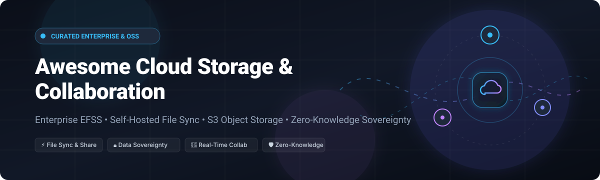

# ☁️ Awesome Cloud Storage & Collaboration 🚀

**Curated collection of premier Enterprise File Sync and Share (EFSS), cloud storage platforms, self-hosted file synchronization engines, and zero-knowledge collaboration suites.**

  
  
  
  
  
  

*An authoritative reference directory for DevOps engineers, enterprise architects, system administrators, and privacy advocates seeking file sync, real-time collaboration, object storage, and data sovereignty.*

---

## 📌 Table of Contents

- [🌐 Sector Overview & Market Dynamics](#-sector-overview--market-dynamics)
- [🏢 SaaS & Hosted Enterprise Platforms](#-saas--hosted-enterprise-platforms)
- [💻 Open-Source GitHub Projects](#-open-source-github-projects)
  - [⚡ File Synchronization & Productivity](#-file-synchronization--productivity)
  - [🪣 Object Storage & Storage Gateways](#-object-storage--storage-gateways)
  - [🛡️ Encrypted Backup & Archival Tools](#️-encrypted-backup--archival-tools)
  - [🌐 Decentralized & P2P Storage Networks](#-decentralized--p2p-storage-networks)
- [💡 Architectural Best Practices & Deployment Guide](#-architectural-best-practices--deployment-guide)
- [🤝 How to Contribute](#-how-to-contribute)
- [⭐ Star History](#-star-history)
- [💖 Support & Sponsorship](#-support--sponsorship)
- [⚖️ Disclaimer](#️-disclaimer)

---

## 🌐 Sector Overview & Market Dynamics

The global **cloud storage and team collaboration market** is estimated at **$135–$160+ billion in 2025–2026** (cloud storage exceeding $100B and cloud collaboration spanning $60B+), expanding at a compound annual growth rate (CAGR) of 15–20% driven by generative AI enterprise workloads, distributed hybrid workforces, and exponential unstructured data accumulation.

### 📊 Competitive Landscape & Fragmentation
The ecosystem presents a **moderately fragmented yet two-tiered concentrated market structure**:
1. **Hyperscaler Concentration:** Foundational cloud storage infrastructure and unified workspace productivity suites are heavily concentrated among hyperscalers (**Microsoft 365 / OneDrive / SharePoint**, **Google Workspace / Drive**, and **AWS S3**), capturing the lion's share of corporate knowledge worker seats.
2. **Specialized & Sovereign Fragmentation:** Strict regulatory governance (**GDPR**, **HIPAA**, **FINRA**, **NIS2**, and **Schrems II**), digital sovereignty mandates, and zero-trust security postures prevent a complete monopoly. This fuels a vibrant, fragmented tier of specialized enterprise file sharing services (Box, Citrix ShareFile, Egnyte, Kiteworks) alongside self-hosted open-source ecosystems (Nextcloud, Seafile, MinIO, Syncthing) that ensure full control over data residency and private cryptographic keys.

---

## 🏢 SaaS & Hosted Enterprise Platforms

A comprehensive analysis of market-leading managed SaaS and Enterprise File Sync & Share (EFSS) platforms, sorted descending by parent company market capitalization and estimated valuation.

| Platform | Company Valuation / Revenue | Starting Paid Price | Free Tier Limits / Free Trial | Key Capabilities & Enterprise Focus |
| :--- | :--- | :--- | :--- | :--- |
| **[Microsoft OneDrive](https://www.microsoft.com/en-us/microsoft-365/onedrive/online-cloud-storage)** 🏢 | **~$3.1 Trillion market cap** (FY24 Microsoft Cloud revenue >$137B) | **$19.99/year** ($1.67/mo) for Microsoft 365 Basic (100 GB) or **$5.00/user/mo** for OneDrive for Business (Plan 1) | **5 GB free storage** (forever); includes web versions of Outlook, Word, and Excel | Native Office 365 co-authoring, SharePoint sync, Copilot AI integration, and Windows/Teams default ecosystem. |
| **[Google Drive](https://drive.google.com/)** 🔍 | **~$2.1 Trillion market cap** (FY24 Google Cloud revenue >$33B) | **$1.99/month** ($19.99/year) for Google One (100 GB) or **$6.00/user/mo** for Google Workspace Business Starter | **15 GB shared free storage** (forever across Google Drive, Gmail, and Google Photos) | Native Google Docs/Sheets/Slides real-time co-editing, Gemini AI assistant, and cloud-native Workspace collaboration. |
| **[Citrix ShareFile](https://www.sharefile.com/)** 💼 | **~$16.5 Billion valuation** (parent Cloud Software Group / Vista & Evergreen; Progress acquisition ~$875M) | **$16.50/user/month** (Advanced plan, billed annually; 3-user minimum: ~$49.50/mo) | **30-day free trial** (unlimited file transfers, up to 5 trial users, full VDR/e-signature features; no permanent free tier) | Secure client portals, built-in legally binding e-signatures, encrypted client document exchange, FINRA/HIPAA compliance. |
| **[OpenText Hightail](https://www.hightail.com/)** 🎨 | **~$8.5 Billion market cap** (OpenText Corporation FY24 revenue ~$5.8B) | **$12.00/month** (Pro plan, billed annually) | **Lite Free Plan** (forever): **2 GB storage**, max **100 MB per file upload**, links expire after 7 days | Visual feedback, creative asset review, side-by-side version comparison, and large media sharing workflows. |
| **[Dropbox](https://www.dropbox.com/)** 📦 | **~$8.2 Billion market cap** (FY24 annual revenue ~$2.55B) | **$9.99/month** (Plus individual, billed annually; 2 TB) or **$15.00/user/mo** (Standard team, 3-user min) | **2 GB free storage** (forever); up to 3 connected devices, 30-day file version recovery | Smart Sync, Dropbox Paper, Replay video review, universal desktop file sync, and multi-platform app integrations. |
| **[Box](https://www.box.com/)** 🗄️ | **~$4.6 Billion market cap** (FY25 annual revenue ~$1.09B) | **$5.00/user/month** (Business Starter, billed annually; 3-user minimum) or **$10.00/mo** (Personal Pro) | **10 GB free storage** (forever); single file upload limit capped at **250 MB**, 1-version history | Enterprise content management, Box AI metadata workflows, FedRAMP High, HIPAA, FINRA, retention policies. |
| **[Egnyte](https://www.egnyte.com/)** 🔄 | **~$3.0 Billion valuation** (backed by Goldman Sachs & Celesta; ~$250M+ ARR) | **$20.00/user/month** (Team/Business plan, billed annually; 1-user minimum, up to 10 users) | **15-day free trial** (up to 5 users, 20 GB storage limit, 1 GB FTP upload cap; no permanent free tier) | Hybrid cloud architecture, local on-premises NAS/SAN caching, automated data classification, ransomware detection. |
| **[Accellion Kiteworks](https://www.kiteworks.com/)** 🔐 | **~$1.5 Billion valuation** (Insight Partners & Sixth Street backed; Private Data Network leader) | **$25.50/user/month** (Business Package, billed annually; 5-user minimum: ~$127.50/mo) | **14-day free trial** (up to 5 users, 1 TB evaluation storage cap; no permanent free tier) | Private Content Network, hardened virtual appliances, FIPS 140-2, FedRAMP Authorized, CMMC 2.0, zero-trust governance. |
| **[pCloud](https://www.pcloud.com/)** 🇨🇭 | **~$150 Million valuation** (profitable Swiss cloud storage vendor; 20M+ users) | **$4.99/month** ($49.99/year) for Premium 500 GB or **$199 lifetime** one-time purchase | **Up to 10 GB free storage** (forever; starts at 2 GB, unlocks to 10 GB via onboarding steps/referrals) | Swiss privacy protection, lifetime license option, client-side zero-knowledge pCloud Encryption (crypto folder). |
| **[Sync.com](https://www.sync.com/)** 🍁 | **~$50 Million valuation** (independent Canadian zero-knowledge EFSS pioneer) | **$8.00/user/month** (Pro Solo Basic, 2 TB billed annually) or **$6.00/user/mo** (Teams Standard, 1 TB) | **5 GB free storage** (forever); zero-knowledge encryption, 3 active share links limit, 30-day file recovery | Client-side end-to-end zero-knowledge encryption, PIPEDA/GDPR compliance, remote wipe, HIPAA business associate agreement. |

---

## 💻 Open-Source GitHub Projects

Curated open-source projects for self-hosted cloud storage, peer-to-peer file sync, object storage, and encrypted backup. Ranked descending by GitHub community star count.

1. **[Syncthing](https://github.com/syncthing/syncthing)**   
   **Open Source Continuous File Synchronization** (MPL-2.0) 🔄  
   *Decentralized peer-to-peer sync between trusted devices without central servers or third-party cloud storage.* Features block-level delta transfers, TLS mutual authentication, cryptographic device IDs, configurable file versioning, NAT traversal relays, and cross-platform clients (Linux, macOS, Windows, Android).

2. **[MinIO](https://github.com/minio/minio)**   
   **High-Performance S3 Compatible Object Storage** (AGPL-3.0) 🪣  
   *The de-facto standard for self-hosted, distributed S3-compatible cloud storage.* Built for Kubernetes-native infrastructure, machine learning pipelines, and cloud-native file storage with enterprise-grade bit-rot protection, server-side encryption (KMS), and multi-tenant object locking.

3. **[Rclone](https://github.com/rclone/rclone)**   
   **"rsync for cloud storage"** (MIT) 🗃️  
   *The ultimate command-line program and sync engine for managing data across 70+ cloud storage backends.* Supports bi-directional sync, encrypted remotes (`rclone crypt`), virtual filesystem mounting (`rclone mount`), chunking, bandwidth throttling, and unified transfers across S3, Google Drive, OneDrive, Nextcloud, and SFTP.

4. **[Nextcloud Server](https://github.com/nextcloud/server)**   
   **Comprehensive Self-Hosted Productivity & Collaboration Suite** (AGPL-3.0) ☁️  
   *The premier open-source on-premises alternative to Microsoft 365 and Google Workspace.* Features real-time multi-user document editing (Nextcloud Office/Collabora), video conferencing & chat (Nextcloud Talk), groupware (Mail, Calendar, Contacts), task tracking (Deck), end-to-end encryption, and 300+ ecosystem integrations.

5. **[Restic](https://github.com/restic/restic)**   
   **Fast, Secure, Efficient Backup Program** (BSD-2-Clause) 🛡️  
   *Secure client-side encrypted backup program for cloud and self-hosted storage targets.* Uses cryptographic deduplication, authenticated symmetric encryption (AES-256), and supports local disks, SFTP, REST servers, AWS S3, MinIO, Wasabi, Backblaze B2, and Azure Blob storage.

6. **[File Browser](https://github.com/filebrowser/filebrowser)**   
   **Lightweight Web File Manager & Personal Cloud Portal** (Apache-2.0) 📂  
   *Extremely fast, standalone web-based file management interface for home labs and dedicated servers.* Single Go binary providing an elegant browser UI with drag-and-drop file uploading, directory sharing links, video playback, user permission control, and integrated terminal command execution.

7. **[IPFS Kubo](https://github.com/ipfs/kubo)**   
   **InterPlanetary File System Reference Implementation** (Apache-2.0 / MIT) 🌐  
   *Peer-to-peer hypermedia protocol designed to preserve and grow humanity's knowledge by making the web upgradeable, resilient, and more open.* Provides content-addressed storage, deduplication, tamper-proof decentralized distribution, and distributed pin-syncing networks.

8. **[Seafile](https://github.com/haiwen/seafile)**   
   **High-Performance File Syncing & Team Collaboration Platform** (AGPL-3.0) 🚀  
   *Engineered for extreme performance and large file syncing via block-level deduplication.* Offers virtual drive client mounting on Windows, macOS, and Linux without exhausting local disk space, document locking for collaborative Office editing, internal wiki management, and SeaTable spreadsheet database integration.

9. **[Duplicati](https://github.com/duplicati/duplicati)**   
   **Open-Source Encrypted Backup Client** (LGPL-2.1) 💾  
   *Client-side encrypted cloud backup with intuitive web UI and automated scheduling.* Employs AES-256 encryption, incremental block-level deduplication, compression, and seamless connectivity to WebDAV, Nextcloud, S3, Google Drive, OneDrive, and SFTP.

10. **[Kopia](https://github.com/kopia/kopia)**   
    **Fast and Secure Open-Source Backup Tool** (Apache-2.0) 🔒  
    *Next-generation encrypted backup engine with content-addressable storage deduplication.* Supports snapshotting, directory mounting as local drives, error-correction coding, graphical desktop UI, and direct connectivity to cloud object storage.

11. **[BorgBackup](https://github.com/borgbackup/borg)**   
    **Deduplicating Archiver with Compression and Encryption** (BSD-3-Clause) 📦  
    *The gold standard in Unix backup and deduplication for system administrators.* Features authenticated client-side encryption (AES-256-OCB), chunk-based deduplication across all snapshots, fast compression (zstd, lz4), and SSH remote execution.

12. **[SFTPGo](https://github.com/drakkan/sftpgo)**   
    **Fully Featured SFTP, HTTP/S, FTP/S & WebDAV Storage Server** (AGPL-3.0) 🚪  
    *High-performance multi-protocol storage gateway for local storage, S3, Azure Blob, and Google Cloud Storage.* Provides web administrative dashboard, end-user web client, virtual folders, quota enforcement, TOTP 2FA, data-at-rest encryption, and automated event actions.

13. **[ownCloud Core](https://github.com/owncloud/core)**   
    **Self-Hosted File Sync and Share Platform** (AGPL-3.0) 🏛️  
    *The pioneering project that defined self-hosted enterprise file sync and sharing (EFSS).* Features federated cloud sharing, LDAP/Active Directory integration, selective sync desktop clients, file version retention, and on-premises compliance governance.

14. **[CryptPad](https://github.com/cryptpad/cryptpad)**   
    **End-to-End Encrypted Real-Time Collaborative Suite** (AGPL-3.0) 🛡️  
    *Zero-knowledge collaborative workspace designed specifically for total privacy.* Includes real-time rich text documents, spreadsheets, slides, kanban task boards, whiteboards, code editors, and forms where all client content is client-side encrypted before transmitting to the server.

15. **[Garage](https://github.com/deuxfleurs-org/garage)**   
    **Lightweight S3-Compatible Distributed Object Storage** (AGPL-3.0) 🦀  
    *Engineered for self-hosting on heterogeneous, geo-distributed clusters with low hardware footprints.* Written in Rust, it excels at providing resilient S3 storage across multi-datacenter community networks without complex cluster setups.

16. **[Storj (Tardigrade)](https://github.com/storj/storj)**   
    **Decentralized, Encrypted S3-Compatible Cloud Storage Network** (AGPL-3.0) 🛰️  
    *Zero-trust decentralized object storage protocol.* Files are client-side encrypted, split into erasure-coded shards, and distributed across a global network of independent storage nodes for superior durability and censorship resistance.

17. **[Pydio Cells](https://github.com/pydio/cells)**   
    **Enterprise Document Management & Advanced File Sharing** (AGPL-3.0) 📑  
    *Microservices-based enterprise file sharing platform written in Go.* Designed for complex compliance, granular RBAC access controls, multi-tenancy, workflow automation rules, and secure content perimeter policies for large enterprises.

18. **[Tahoe-LAFS](https://github.com/tahoe-lafs/tahoe-lafs)**   
    **Least-Authority File Store** (GPL-2.0+) 🔐  
    *Fault-tolerant, decentralized, privacy-respecting distributed storage system.* Distributes encrypted erasure-coded shares across independent servers, guaranteeing confidentiality and integrity even when storage nodes fail or are compromised.

---

## 💡 Architectural Best Practices & Deployment Guide

When designing enterprise storage pipelines or self-hosting on your private cluster:
- **Collaboration vs. Performance**: Deploy **Nextcloud** for full team office productivity (Office suite, Calendar, Chat, Deck). For engineering workloads handling thousands of media files, CAD assets, and binary delta transfers, pair with **Seafile** or **Syncthing**.
- **Object Storage Foundation**: Avoid storing raw uploads directly on single filesystem volumes. Use **MinIO** or **Garage** as an S3 storage backend to achieve high durability, bit-rot self-healing, and seamless multi-region bucket replication.
- **Client-Side Zero-Knowledge**: While server-side encryption at rest (LUKS, SSE-S3) protects against offline drive theft, true data confidentiality against subpoena or host compromises requires client-side zero-knowledge encryption (**CryptPad**, **Sync.com**, or **Rclone crypt** remotes).
- **Immutable Backup Stratum**: Follow the **3-2-1 backup rule** (3 copies, 2 distinct media types, 1 offsite/air-gapped). Integrate **Restic**, **Borg**, or **Kopia** with snapshot retention and append-only cloud repositories.

---

## 🤝 How to Contribute

Contributions, project suggestions, and documentation fixes are warmly welcomed! 🌟

1. 🍴 **Fork the repository** on GitHub.
2. 🌿 **Create a new branch**: `git checkout -b feature/add-new-storage-tool`.
3. 📝 **Add or edit entries** in `README.md` following the established formatting, emoji guidelines, and pricing/star badge rules.
4. 🔎 Ensure URLs are active, accurate, and relevant to cloud storage/collaboration.
5. 🚀 **Commit your changes**: `git commit -m "Add ToolName to open-source storage list"`.
6. 📬 **Open a Pull Request** with a concise summary of the addition.

---

## ⭐ Star History

---

## 💖 Support & Sponsorship

If you found this curated list helpful for your architecture decisions, team workflows, or homelab deployment, please consider showing your support:

- ⭐ **Star this repository** to improve visibility for the developer community!
- 🍴 **Fork and share** with colleagues, dev teams, and homelab enthusiasts!
- ☕ **Support the maintainer**: Buy a coffee or sponsor ongoing maintenance and research via the [GitHub Sponsors Dashboard](https://github.com/sponsors/ishandutta2007).

Your backing ensures this ecosystem guide remains meticulously up-to-date, transparent, and accurate. Thank you! 🙏

---

## ⚖️ Disclaimer

- This directory is a **community-curated, independent index** — listings do not constitute commercial endorsement or partnership.
- Cloud storage platforms handling confidential, financial, or personal data must comply with applicable data protection regulations (GDPR, CCPA, HIPAA, etc.) and implement strict zero-trust access controls.
- **Self-hosted cloud storage responsibility**: Running self-hosted storage instances requires disciplined server administration, TLS certificate rotation, failover planning, and tested disaster recovery routines.

---

**Made with ❤️ for privacy-conscious teams, DevOps engineers, and organizations building transparent, sovereign cloud storage solutions.**  
*Let's make Cloud Storage & Collaboration more open, data-driven, and sovereign.*

